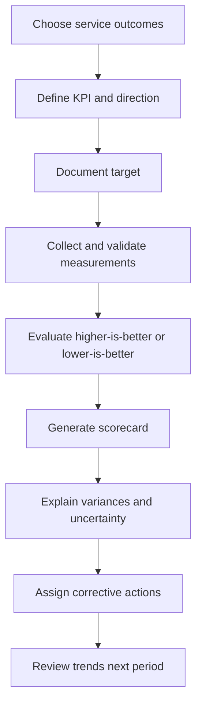

# Technology scorecard measurement workflow

The implementation currently covers evaluation and text reporting; measurement ingestion, owner assignment, trends and action tracking are future enhancements. All included examples are fictional.

Run `python cli.py examples/fictional-metrics.json`.
